# Catalog vizual HUB AUTO — LAB

Actualizare: **22.10.2026**. Exclusiv `/home/aza/HUB AUTO/HUB_v2-LAB`, Five Server `http://127.0.0.1:5500/`.

**Ultima completare: 7 capturi, 332.749 octeți (325,0 KiB).** Catalogul conține în total **12 JPEG, 644.947 octeți (629,8 KiB)**. Toate cele 5 imagini găsite la începutul rundei sunt păstrate.

## Completare — Constatări, devize și avansuri (22.10.2026)

**7 capturi noi, exclusiv DEMONSTRATIV/LAB.** Toate provin din interfețele reale servite la `http://127.0.0.1:5500/`. Nu s-au creat pagini independente, nu s-au modificat DOM-ul sau fișierele aplicației și nu s-au încercat ocoliri ale restricțiilor browserului.

### Salvare și proveniență

- Dashboard și contul `user_admin` au fost verificate înainte de capturi; scriptul Five Server indică `/home/aza/HUB AUTO/HUB_v2-LAB/index.html`.
- Imaginile 12–17: date completate fictiv prin câmpurile și butoanele de adăugare a liniilor existente. **Nesalvate în Supabase.** Formularele Constatări și Avansuri au fost anulate; Deviz Estimativ a fost părăsit fără salvare. Nu s-au apăsat Salvează, Importă Date, Importă Avans sau Printează.
- Deviz Final păstrează automat o ciornă locală în browser. Ciorna fictivă `LABDEMO · Deviz nou`, creată în această rundă, a fost eliminată prin „Ciorne locale” → „Șterge ciorna”. Interfața a confirmat: „Ciorna locală a fost ștearsă. Modificările din formular nu sunt salvate.” Nu a fost șters sau modificat un deviz din baza de date.
- Imaginea 18 folosește exclusiv datele demo preexistente din `initialAdvances`, fără adăugare/editare de plăți sau schimbare de status. **Nicio salvare nouă.** Nu reprezintă dovadă de încasări reale sau de citire a plăților din Supabase.
- JPEG-urile sunt decupaje native, optimizate și inspectate vizual. Fără retușarea conținutului, erori, mesaje de încărcare sau date personale reale. Câmpurile personale neesențiale au rămas goale. Brandingul și valorile implicite ale aplicației au fost păstrate.
- Nu s-a schimbat viewportul în această rundă. Tabul a revenit la Dashboard. Toate cele 5 imagini preexistente au fost păstrate intacte.

### Inventar nou

| Fișier | Componente și limite | Dimensiuni | Mărime | Surse HTML/CSS/JS |
|---|---|---|---|---|
| [12_constatare_DEMONSTRATIV.jpg](12_constatare_DEMONSTRATIV.jpg) | Constatări v2: formular nou, date vehicul/client, status general, sesizare, observații și repartizare. Nu este un card salvat și nu include taburile departamentale. | 1002 × 1367 px | 83.897 octeți | [HTML](../../modules/formulare/constatari_v2.html), [CSS](../../css/constatari_v2.css), [JS](../../js/constatari_v2.js); `#detailPane`, `.general-vehicle-card`, `.general-client-card`, `.control`, `#statusSelect`, `generalContent()` |
| [13_deviz_estimativ_DEMONSTRATIV.jpg](13_deviz_estimativ_DEMONSTRATIV.jpg) | Deviz Estimativ: antet fictiv, 3 linii (serviciu și piese), cantități, prețuri, total calculat 1.020 RON. | 985 × 460 px | 44.695 octeți | [deviz.html](../../modules/devize/deviz.html), CSS/JS inline și Tailwind; `#screen-id-deviz`, `#screen-items-table`, `.row-desc`, `.row-qty`, `.row-price` |
| [14_deviz_final_antet_DEMONSTRATIV.jpg](14_deviz_final_antet_DEMONSTRATIV.jpg) | Deviz Final: antet, date fictive client/vehicul, kilometraj și navigare între secțiuni. DF-001 este identificatorul inițial propus de formular, nu un document salvat. | 969 × 800 px | 47.166 octeți | [deviz_final.html](../../modules/devize/deviz_final.html), Tailwind și JS inline; `#tab-antet`, `#input-client-deviz-final`, `#input-tip-auto-deviz-final` |
| [15_deviz_final_manopera_DEMONSTRATIV.jpg](15_deviz_final_manopera_DEMONSTRATIV.jpg) | Deviz Final: 2 operații fictive, timp, tarif, valori 300 + 150 lei și total manoperă 450 lei. | 969 × 489 px | 38.905 octeți | [deviz_final.html](../../modules/devize/deviz_final.html), Tailwind și JS inline; `#tab-manopera`, `#manopera-rows-body`, `.manopera-denumire`, `.manopera-timp`, `.manopera-tarif` |
| [16_deviz_final_piese_avans_DEMONSTRATIV.jpg](16_deviz_final_piese_avans_DEMONSTRATIV.jpg) | Deviz Final: 2 piese fictive, cantități/prețuri, total piese 720 lei, total de plată 1.170 lei, Include avans bifat și buton Importă Avans. Niciun avans nu este importat sau scăzut. | 969 × 656 px | 54.557 octeți | [deviz_final.html](../../modules/devize/deviz_final.html), Tailwind și JS inline; `#tab-piese-materiale`, `#piese-rows-body`, `.piesa-denumire`, `#input-include-avans`, `#btn-importa-avans` |
| [17_avans_modal_DEMONSTRATIV.jpg](17_avans_modal_DEMONSTRATIV.jpg) | Evidență Avansuri: modal real Adaugă Avans, vehicul fictiv, plată inițială 500 lei/Card și observații DEMONSTRATIV/NESALVAT. Nu este o încasare înregistrată. | 545 × 689 px | 30.771 octeți | [avans.html](../../modules/devize/avans.html), CSS/JS inline și Tailwind; `#avansModal`, `.panel-card`, `#avansForm`, `#initialPaymentAmount`, `#initialPaymentMethod` |
| [18_cn_plati_status_DEMONSTRATIV.jpg](18_cn_plati_status_DEMONSTRATIV.jpg) | C&N — exemplu existent GESTIUNE FINANCIARĂ DEMO: fișa AV-002, două plăți fictive (400 lei Card și 450 lei OP), total 850 lei și badge Avans încasat. Este modalul C&N, nu lista din avans.html. | 986 × 365 px | 32.758 octeți | [HTML](../../modules/devize/clienti-notificari.html), [CSS](../../css/clienti-notificari.css), [JS](../../js/clienti-notificari.js); `#advanceModal`, `.cn-advance-modal`, `.cn-financial-status`, `initialAdvances`, `renderAdvanceManager()` |

### Blocaje confirmate și acoperire

- **Constatări v2:** `cars` pornește ca listă goală în JS; după încărcare, pagina are 0 înregistrări. Contoarele HTML inițiale nu sunt fixture-uri populate. Cardurile cu statusuri diferite, detaliile unei fișe salvate și taburile Mecanică/Electrică necesită înregistrări; nu s-au creat. Captura 12 prezintă numai formularul nou, nesalvat, cu selectorul statusului general.
- **Devize:** antetul și liniile au putut fi completate fără salvare. Deviz Estimativ are o listă comună Piesă/Serviciu; nu are separarea manoperă/piese a Devizului Final. Zona de avans din DF este exemplificată prin controalele reale, fără avans importat; valoarea 1.170 lei nu include o scădere de avans.
- **Evidență Avansuri:** lista principală este goală. Istoricul de plăți și statusul unei fișe salvate nu au fost fabricate. Captura 17 arată plata inițială din formular; captura 18 arată separat demonstrația de plăți multiple deja disponibilă în C&N.
- Obiectivul este acoperit prin exemplele permise de interfața nesalvată; lista de carduri Constatări și o fișă reală de avans cu istoric rămân indisponibile în aceste limite. Capturile nu sunt un test de salvare sau o validare completă a fluxurilor.

### Previzualizări — DEMONSTRATIV, fără salvare în baza LAB

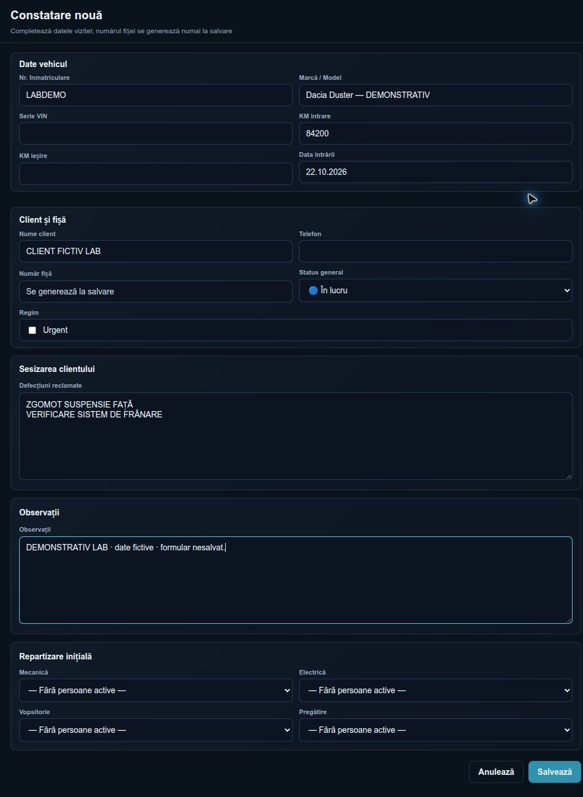

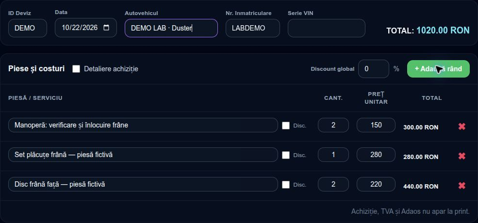

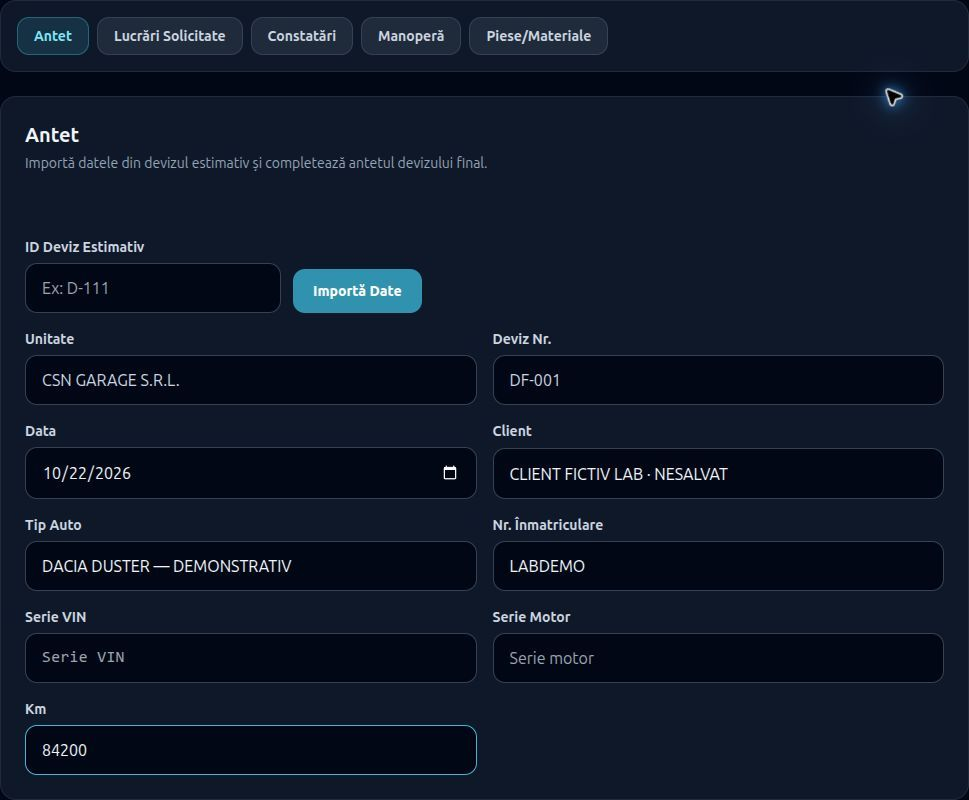

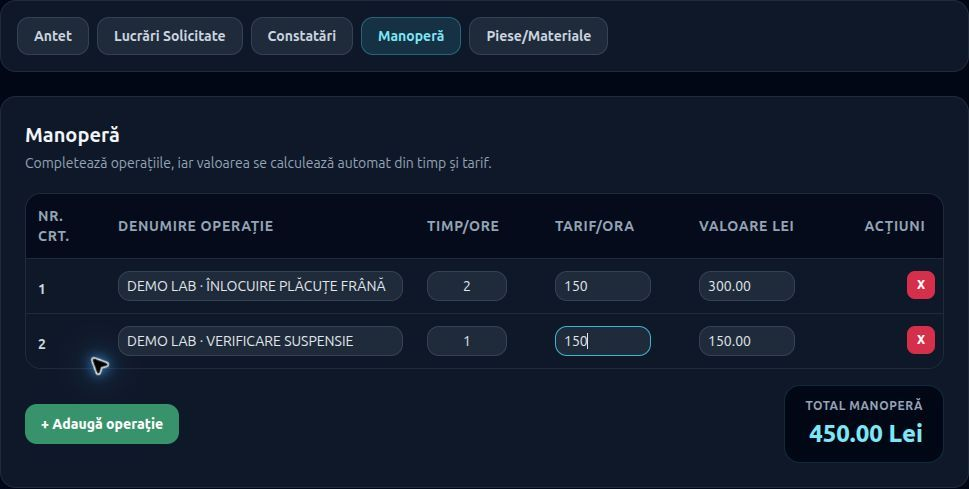

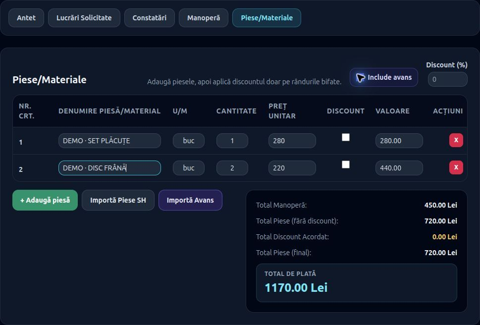

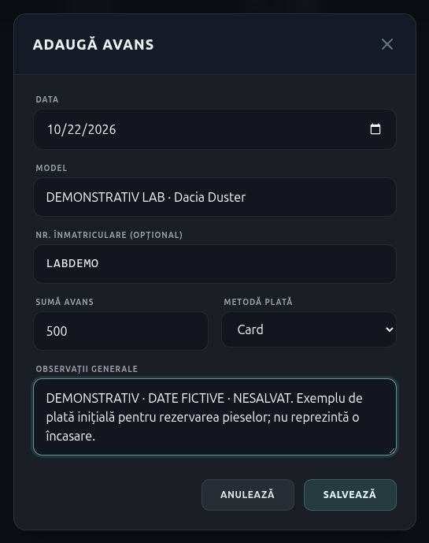

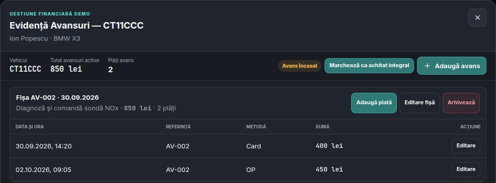

## Prima rundă — SH și dosarul C&N (DEMONSTRATIV)

Aceste imagini prezintă exclusiv exemple fictive. Nu dovedesc încărcarea unor înregistrări din baza LAB, salvarea datelor, automatizarea notificărilor sau funcționarea fluxurilor financiare.

| Fișier | Componente prezentate | Dimensiuni | Mărime | Surse HTML/CSS și randare |
|---|---|---|---|---|
| [08_comenzi_sh_modal_DEMONSTRATIV.jpg](08_comenzi_sh_modal_DEMONSTRATIV.jpg) | Modal real „Adaugă piesă”, câmpuri completate fictiv, departament, furnizor, total calculat 685 RON; formular nesalvat | 760 × 730 px | 50.085 octeți | [HTML](../../modules/devize/comenzi_piese_sh.html), [CSS](../../css/comenzi_piese_sh.css), [JS](../../js/comenzi_piese_sh.js); `.parts-modal`, `.parts-modal-card`, `.parts-field`, `.parts-modal-footer`, `updateLiveTotal()` |
| [09_clienti_dosar_general_DEMONSTRATIV.jpg](09_clienti_dosar_general_DEMONSTRATIV.jpg) | Dosar client demo: antet, tab General selectat, contact fictiv, badge-uri de canale, 3 carduri vehicul, selecție | 622 × 577 px | 32.491 octeți | [HTML](../../modules/devize/clienti-notificari.html), [CSS](../../css/clienti-notificari.css), [JS](../../js/clienti-notificari.js); `#clientDrawer`, `.cn-dossier-header`, `.cn-dossier-tabs`, `.cn-card`, `.cn-vehicle-card`, `initialClients`, `renderDossier()`, `generalTab()` |
| [10_clienti_dosar_avansuri_DEMONSTRATIV.jpg](10_clienti_dosar_avansuri_DEMONSTRATIV.jpg) | Tab Avansuri demo: 3 vehicule, fișe/plăți fictive, badge-uri „Avans încasat” / „Fără avans”, total fictiv 1.350 lei | 622 × 687 px | 40.744 octeți | [HTML](../../modules/devize/clienti-notificari.html), [CSS](../../css/clienti-notificari.css), [JS](../../js/clienti-notificari.js); `.cn-dossier-tabs`, `.cn-financial-status`, `.cn-money`, `initialAdvances`, `advancesTab()` |
| [11_clienti_dosar_istoric_DEMONSTRATIV.jpg](11_clienti_dosar_istoric_DEMONSTRATIV.jpg) | Tab Istoric service demo: 3 evenimente, date, descrieri, badge-uri Finalizat/Acceptat/Închis; mențiunea existentă „Date fictive” | 622 × 560 px | 26.570 octeți | [HTML](../../modules/devize/clienti-notificari.html), [CSS](../../css/clienti-notificari.css), [JS](../../js/clienti-notificari.js); `#clientDrawer`, `.cn-dossier-tabs`, `.cn-status`, `initialClients[].vehicles[].service`, `serviceTab()` |

### DEMONSTRAȚIE LAB — modal SH, formular nesalvat

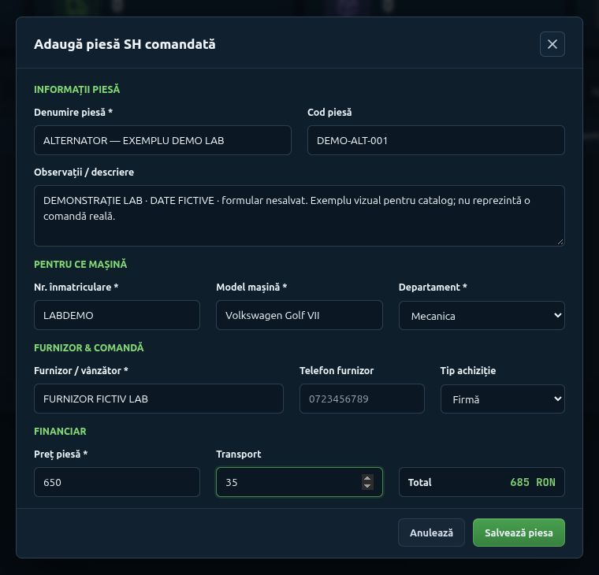

### DEMONSTRAȚIE LAB — dosar client, General

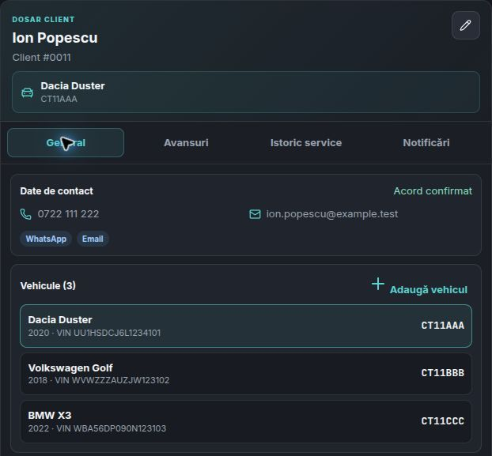

### DEMONSTRAȚIE LAB — dosar client, Avansuri

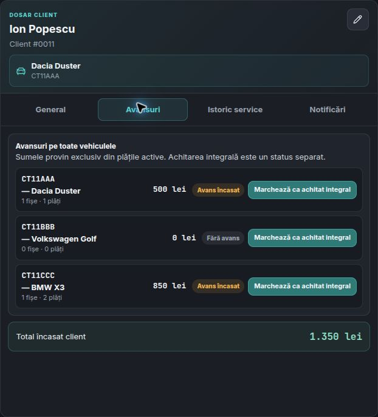

### DEMONSTRAȚIE LAB — dosar client, Istoric service

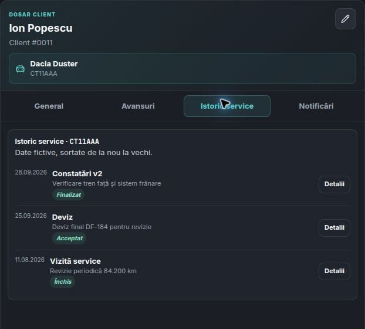

## Proveniență și verificări — prima rundă din 22.10.2026

- Adresa HTTP și sesiunea au fost verificate înainte de capturi: Dashboard `http://127.0.0.1:5500/index.html`, cont afișat `user_admin`; scriptul Five Server are `data-file=/home/aza/HUB AUTO/HUB_v2-LAB/index.html`. Manager a confirmat separat același checkout prin `data-file`.
- Nu s-au citit sau exportat tokenuri, parole ori chei. Nu s-a accesat producția și nu s-au efectuat autentificări noi.
- Modalul SH a fost completat prin controalele existente. Denumirea și observațiile marchează explicit demonstrația. Telefonul furnizorului a rămas gol; cifrele gri sunt placeholderul HTML. Nu s-a apăsat „Salvează piesa”; modalul a fost închis prin „Anulează”.
- Dosarul C&N provine din fixture-urile `initialClients` și `initialAdvances` deja existente în JS, cu email `example.test`. Nu reprezintă date personale reale sau rânduri încărcate din Supabase. S-au folosit taburile existente General, Avansuri și Istoric service; nu s-au apăsat comenzile de editare, plată, achitare sau trimitere.
- Pentru layoutul desktop listă/dosar a fost folosit temporar viewport 1600 × 1000; configurația a fost restaurată la final, iar tabul a revenit la Dashboard.
- JPEG-uri native ale browserului, decupate la componentele relevante, apoi optimizate JPEG progresiv, calitate 80, fără redesenare sau retușare a conținutului. Fiecare imagine finală a fost inspectată vizual; nu conține stări de încărcare sau mesaje de eroare.
- Nu s-au modificat DOM-ul aplicației, HTML, CSS, JS, alte documente sau configurații. Nu s-au creat/modificat înregistrări în Supabase. Nu s-au instalat pachete; fără commit, push sau deploy. Deschiderea paginilor poate executa mecanismele pasive de sesiune/audit existente; nu s-a verificat un audit DB al acestora.

## Limitele primei runde — păstrate pentru context

| Prioritate | Observație verificată | Rezultat |
|---|---|---|
| Constatări v2 — carduri/statusuri/detalii/taburi | După încărcare lista are 0 înregistrări. Cele 6 afișate tranzitoriu provin din HTML-ul static, nu din date încărcate. | Nu s-au salvat alte capturi goale. Exemplul populat rămâne blocat. |
| SH — tabel populat și badge-uri | Tabelul real afișează „Nicio comandă găsită.” | Tabelul populat rămâne blocat; modalul completat fictiv este livrat. |
| C&N — tabel și dosar | Tabelul real afișează „Eroare la încărcare”. Dosarul demo existent este populat separat. | Nu s-a salvat eroarea în capturile noi; decupajele prezintă doar dosarul demo. Tabelul populat rămâne blocat. |
| Manager — KPI și grafice | Pagina se încarcă, dar KPI-urile și toate cele 6 luni au valoare zero. | Nu s-a duplicat captura goală istorică. Exemplul financiar populat nu este disponibil. |

S-a pregătit în memorie o prezentare temporară cu sursele reale și fixture-uri fictive, fără fișiere de aplicație. Browserul a respins navigarea `data:` deoarece politica sa permite numai HTTP/HTTPS. Prezentarea nu s-a deschis, nu a fost capturată și nu este livrată. Restricția nu a fost ocolită; nu s-a pornit un server alternativ și nu s-a folosit o altă suprafață pentru aceeași acțiune blocată. Obiectivul este **parțial realizat**, nu validare funcțională completă.

## Arhivă — capturi din 21.10.2026, păstrate intacte

Inventarul de mai jos provine din indexul anterior. **Fișierele 02–07 erau deja absente de pe disc la începutul acestei runde**; nu au fost șterse sau reconstruite în această intervenție. Dimensiunile și mărimile lor sunt informații istorice, excluse din totalul fizic actual. Numai 01 și 08–11 existau efectiv. Stările goale și captura istorică cu eroare rămân excluse din recomandări.

| Fișier | Conținut istoric și limită | Dimensiuni | Mărime | Surse |
|---|---|---|---|---|
| [01_dashboard_hub.jpg](01_dashboard_hub.jpg) | Dashboard, navigare, alerte și carduri; indicatori parțial zero | 2560 × 1233 px | 162.308 octeți | [index.html](../../index.html), CSS inline/Tailwind |
| 02_avansuri_antet_inapoi.jpg — ABSENT | Referință antet și Înapoi, păstrată | 1440 × 180 px | 18.425 octeți | [avans.html](../../modules/devize/avans.html), CSS inline, `.page-header`, `.back-link` |
| 03_constatari_v2_stare_goala.jpg — ABSENT | Listă goală; exclusă din exemplele populate | 2560 × 1233 px | 49.995 octeți | [HTML](../../modules/formulare/constatari_v2.html), [CSS](../../css/constatari_v2.css) |
| 04_clienti_notificari_panouri.jpg — ABSENT | Conține eroare de încărcare; exclusă din catalogul recomandat, nerecapturată | 2560 × 1233 px | 151.507 octeți | [HTML](../../modules/devize/clienti-notificari.html), [CSS](../../css/clienti-notificari.css) |
| 05_manager_kpi_grafic.jpg — ABSENT | KPI și grafic cu zero; fără serie financiară populată | 2560 × 1233 px | 132.419 octeți | [HTML](../../modules/manager/manager.html), [CSS](../../modules/manager/manager.css), [JS](../../modules/manager/manager.js), `.primary-kpi`, `.trend-chart` |
| 06_comenzi_sh_tabel.jpg — ABSENT | Tabel gol | 1440 × 680 px | 48.421 octeți | [HTML](../../modules/devize/comenzi_piese_sh.html), [CSS](../../css/comenzi_piese_sh.css) |
| 07_comenzi_sh_modal.jpg — ABSENT | Formular necompletat; preferă demonstrația 08 | 760 × 730 px | 38.699 octeți | [HTML](../../modules/devize/comenzi_piese_sh.html), [CSS](../../css/comenzi_piese_sh.css) |

Limita ultimei intervenții: cele 7 JPEG noi (12–18) și acest `INDEX.md`. Cele 5 imagini existente (01, 08–11) sunt intacte. Celelalte fișiere, inclusiv modificările preexistente din checkout, au fost păstrate.
Referințe: [DESIGN_SYSTEM_HUB.md](../DESIGN_SYSTEM_HUB.md), [AI_START_HERE.md](../AI_START_HERE.md).
